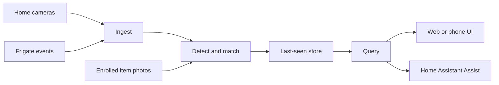

# ItemLocus

ItemLocus is a local-first, open-source project that helps people find everyday belongings at home. It works with existing security cameras to remember where items such as keys, tools, wallets, remotes, or glasses were last seen, and to answer questions like **"Where are my keys?"**

This repository is in **planning**. It currently contains documentation and a project scaffold only. There is no application or detection code yet.

## Who it is for

- People living with dementia or other forms of memory loss who want a respectful, practical way to find things they have set down
- Caregivers and family members who are asked "where did I put it?" many times a day
- Anyone who has trouble keeping track of belongings, whether that is occasional forgetfulness or a more persistent challenge

The project aims to support independence and reduce time spent searching. It is **not** a medical device, and it does not diagnose or treat any condition.

## Design principles

- **Local first.** Detection, memory, and answers run on hardware you control. There is no cloud service in the default configuration.
- **Privacy by default.** Cameras are opt-in one at a time. The system stores an object crop, a room or zone name, a time, and a confidence score — not faces, not people, and not a continuous video archive of the household.
- **Honest answers.** If the system is not confident, it says it is not sure. A wrong room, stated with certainty, is worse than "I don't know."
- **Reuse what you already have.** ItemLocus is not a new video recorder. It is designed to sit alongside [Frigate](https://frigate.video/) when you have it, or to take RTSP or snapshot feeds from ordinary cameras when you do not.
- **Fixed cameras first.** The first version watches rooms, not a wearable camera on a person. A wearable mode may be explored later; it is not part of the initial product.

## Project status

| Area | Status |
| --- | --- |
| Public documentation | In progress (this repository) |
| Item enrollment, detection, and last-seen store | Not started |
| Query UI and voice assistant | Not started |
| Builds, packages, or releases | None — no implementation work until the docs are accepted and a later milestone is approved |

See [docs/ROADMAP.md](docs/ROADMAP.md) for planned milestones, risks, and non-goals. See [docs/AI-INTEGRATION.md](docs/AI-INTEGRATION.md) for the planned AI architecture. See [docs/PRIVACY.md](docs/PRIVACY.md) for privacy rules. See [CONTRIBUTING.md](CONTRIBUTING.md) if you want to help.

## How it is planned to work

1. **Connect cameras.** Prefer Frigate's event and snapshot API when Frigate is already running. Otherwise, accept RTSP streams or periodic stills from ONVIF or RTSP cameras. Each camera is mapped to a named room or zone, such as "kitchen" or "workbench."
2. **Enroll items.** A person or caregiver takes a few photographs of an item, gives it a name ("the house keys", "the red toolbox"), and ItemLocus stores a local visual embedding. No cloud training step.
3. **Watch for last seen.** When a camera view may contain an enrolled item, ItemLocus tries to detect it and match it to the enrollment. On a confident match it updates a last-seen record: room or zone, time, confidence, and a crop of the object only.
4. **Ask.** From a simple web or phone page, or by voice through Home Assistant Assist, someone asks "Where are my keys?" The reply is a short sentence, a time, and the crop — or a clear "I'm not sure."

Bathrooms and bedrooms should stay off unless a household deliberately turns them on. Privacy masks should hide beds and other excluded regions. See [docs/PRIVACY.md](docs/PRIVACY.md).

## What this is not

ItemLocus is not a replacement NVR, a face-recognition system, a people tracker, a medical product, or a tag-based finder (such as Bluetooth trackers). Those tools can be useful in their own ways; they are out of scope here. A longer list is in the [roadmap](docs/ROADMAP.md#non-goals).

## Hardware, in brief

The intended first target is a home computer or small server that can already run Frigate, with an optional accelerator (for example a Coral, Hailo, Intel iGPU or NPU, NVIDIA GPU, or Apple Silicon). Open-vocabulary detection and embeddings need more memory than a basic motion recorder; a typical recommendation is 16 GB of RAM. A Raspberry Pi is not the planned sole host for the first models. Camera placement and a clear view of counters, tables, and benches matter more than camera brand. Details are in [docs/AI-INTEGRATION.md](docs/AI-INTEGRATION.md#hardware-tiers).

## Contributing

Documentation improvements, issue reports, and careful discussion of privacy and accessibility are welcome. Please read [CONTRIBUTING.md](CONTRIBUTING.md) before opening a pull request. In short:

- Keep the project generic and public. Do not commit household-specific paths, names, addresses, camera inventories, or anyone's photographs.
- Do not include images of faces, people, medicine or related gear, nudity, identity documents, or other private material — not even as examples.
- Use respectful language about dementia, memory loss, aging, and disability. Write *with* the people who may use this, not about them as a problem to be managed.
- Prefer local, inspectable approaches over cloud defaults.
- Confirm the contributor terms and sign off your commits as described in [CONTRIBUTING.md](CONTRIBUTING.md).

Code contributions are not open yet, because there is no application code. When implementation begins, this section will describe how to run tests, the license of any bundled models, and the review process.

## License

Copyright (C) 2026 the ItemLocus author (github.com/lundgren-greg).

ItemLocus is free software: you can redistribute it and/or modify it under the terms of the [GNU Affero General Public License v3.0](LICENSE) as published by the Free Software Foundation.

"Frigate" is a trademark of Frigate, Inc. ItemLocus plans to integrate with Frigate; it is not an official Frigate project.
