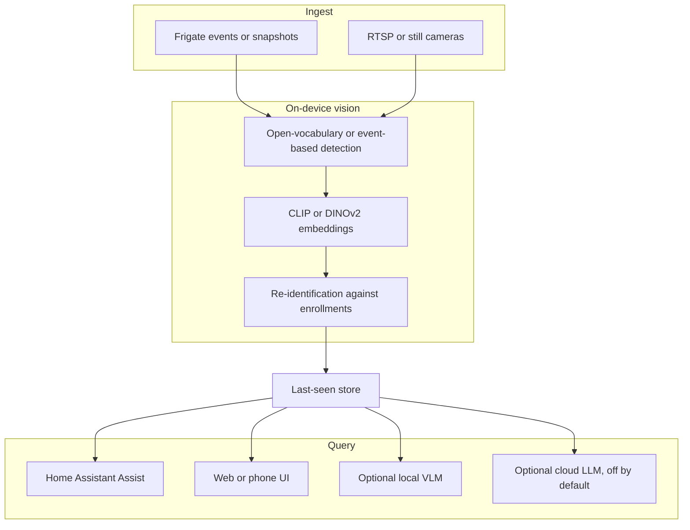

# AI integration plan

This document describes how ItemLocus is planned to use machine learning. Nothing here is implemented yet. The goals are local-first inference, honest answers, and a clear path for later improvements.

## Design in brief

Every user-facing answer should be grounded in the last-seen store (and, when shown, the object crop). Models must not invent a room.

## Local detection

Two complementary paths are planned. A household may use one or both.

1. **Frigate events (preferred when Frigate is present).** Subscribe to Frigate MQTT events and fetch the associated snapshots. Use Frigate for decode, motion gating, and recording. ItemLocus then looks inside those event snapshots for enrolled items. This avoids running a heavy detector on every frame.
2. **Direct RTSP or stills.** For cameras not in Frigate, take periodic stills (or short clips) from RTSP or ONVIF sources and run detection locally.

Open-vocabulary detectors such as YOLO-World, OWL-ViT, or Grounding DINO are the planned class-level net: they can look for "keys", "hammer", or "wallet" without a custom trained label set. A conventional YOLO model may also be used when a household only needs a small, known set of classes, or as a first-pass filter.

Detection should:

- Run only on opted-in cameras
- Honor privacy masks before inference, not after
- Discard person and face regions; never write them to the last-seen store
- Prefer event-triggered stills over continuous full-frame analysis on modest hardware

## Few-shot enrollment and re-identification

Users enroll *their* items, not a generic class.

- A name plus about 3–10 photographs is the planned enrollment. Photos stay on the local machine.
- Store visual embeddings with a local model in the CLIP or DINOv2 family (or a later equivalent that can run on-device). These embeddings are the memory of "what this item looks like."
- At detection time, compare new object crops to enrolled embeddings (re-identification). A match above a calibrated threshold updates last-seen; a weak match does not.
- Support more than one instance of a similar object with distinct names ("front-door keys" vs "shed keys").
- Enrollment photos are often close-up and well lit, while camera frames are wide and dim. The plan should account for that domain gap: enrollment guidance now, and optional in-situ snapshots later.

Research such as Swiss DINO points at one-shot personal object search with DINOv2 features. ItemLocus would need an implementation under a license compatible with AGPL-3.0; non-commercial research code cannot simply be copied in.

## Last-seen store

For each enrolled item, keep:

- Last camera and named room or zone
- Timestamp
- Confidence score
- An **object-only crop** (not a full-room still, and never a face or person crop)

Optional short history (for example the last three places) can help a person judge a doubtful latest match. Retention is capped and configurable. Deleting an item, a crop, or the whole store must be straightforward. Strip location metadata from any kept stills. Do not write street addresses or precise coordinates into exports.

The store is the only source of truth for answers. See also [PRIVACY.md](PRIVACY.md).

## Natural-language Q&A

The default query path does not need a large language model: extract the item name from the question, look it up in the store, and return a short, templated answer ("Kitchen counter. Seen today, 2:14 PM.") plus the crop, or "I'm not sure."

An **optional local vision-language or language model**, for example through Ollama with a Qwen2.5-VL or LLaVA-class model, may be offered for follow-up questions and more flexible phrasing. It must be grounded only in the last-seen store (and, if used, the object crop already in the store). It must not search raw camera history on its own, and it must not invent locations. If the store has no confident record, the model still says it is not sure.

A **cloud LLM is optional, off by default, and requires an explicit opt-in.** When enabled, data minimization rules apply:

- Do not send images by default. If a future setting allows sending a crop, it stays off until turned on, and it should send only the object crop, never a room still or a person.
- Send only the minimum text needed for the question (item name, room, time, confidence, and the user's question).
- Do not send enrollment photos, raw camera frames, household maps beyond the room name, or other items in the store.
- Label the setting clearly as a cloud service. Local answers must keep working when the option is off or the network is down.

## Home Assistant Assist

Plan a voice intent for Assist, such as "Where are my keys?" The response should be short enough to hear clearly, and should use the same confidence rules as the screen UI. The web or phone page remains available for people who prefer to see the crop, and for a large-text caregiver mode. Offer both voice and picture; people have different needs.

## Confidence and honest answers

Confidence scoring is a first-class part of the product, not a later polish step.

- Calibrate thresholds on realistic indoor stills (small objects, clutter, dim light, look-alikes), not only on clean enrollment photos.
- Below the threshold, or when an item has not been seen within the retention window, the answer is "I'm not sure" (or equivalent), never a guessed room.
- Show the crop whenever a location is offered, so a person can disagree.
- Prefer under-claiming to over-claiming. A wrong room stated with certainty is treated as a serious failure, especially for users living with memory loss.
- Log enough locally to evaluate false positives and false negatives, without keeping person or face imagery.

## Privacy safeguards

These rules apply to every AI path, including optional models:

- Never store faces or person crops
- Keep object-only crops, with retention limits
- Honor privacy masks, applied before inference
- Opt-in per camera; bathrooms and bedrooms off by default
- No cloud by default; opt-in is explicit and minimized
- Do not target, enroll, or retain sensitive categories (medicine and related gear, nudity, identity documents, or other private data). If a frame cannot be classified safely, drop it

See [PRIVACY.md](PRIVACY.md) for the household-facing policy.

## Hardware tiers

| Tier | Typical hardware | Planned capability |
| --- | --- | --- |
| Modest | 64-bit PC or small server, about 8–16 GB RAM, no accelerator | Frigate event snapshots plus a lighter detector or fewer cameras; templated answers; local embeddings may be slow |
| Recommended | 16 GB RAM or more, plus a Coral, Hailo, Intel iGPU or NPU, NVIDIA GPU, or Apple Silicon | Open-vocabulary detection, local embeddings, and comfortable event-time updates |
| Optional heavier | The recommended tier plus spare GPU or NPU memory | Optional local VLM for freer Q&A, still grounded in the store |

A Raspberry Pi is not the planned sole host for the first open-vocabulary and embedding models. Indoor cameras should view the surfaces where items are actually left (counters, tables, benches). Height, focus, and lighting matter more than brand.

## Evaluation plan

Before calling a milestone done, measure at least:

- Enrollment quality: can a new item be matched from a different camera angle and lighting?
- Last-seen accuracy: room and item identity on a held-out set of stills, including small objects and look-alikes
- False-confident answers: how often a wrong room would have been shown if the threshold were ignored, and how often the shipped threshold says "not sure" instead
- Latency: time from a Frigate event or still to a store update, and time from a question to an answer
- Privacy checks: automated tests that person or face crops are not written, and that masked regions are not stored
- Accessibility: large-text mode remains readable when an answer includes a crop and a time

Use public or synthetic indoor stills and contributor-provided fixtures. Do not commit household photographs or anyone's personal items to the repository.

## Model licensing notes

- Prefer models and weights whose licenses allow use, distribution, and modification under this project's [AGPL-3.0](../LICENSE) license, including when a server offers the feature over a network.
- Record the license of every bundled or downloaded model in the docs when implementation begins.
- Do not import research or vendor code that is non-commercial only, or that cannot be combined with AGPL-3.0, without a clearly documented exception and a replacement plan.
- Optional cloud providers have their own terms; they are not a substitute for local model license review.
- Frigate, Home Assistant, Ollama, and similar tools are integrations, not dependencies that change this project's license. Do not use their names or logos in a way that implies official status.
