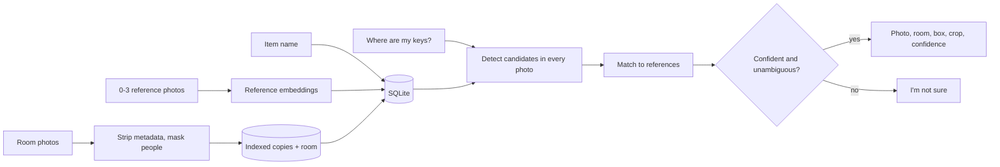

# Photo-only test

A way to try the core idea today with a handful of still photos: no camera, no Frigate, no RTSP. You put a few room photos in a folder, enroll an item, and ask "Where are my keys?" This is a **prototype to learn from**, not the MVP in the [roadmap](ROADMAP.md). It follows the same rules as [PRIVACY.md](PRIVACY.md) and [AI-INTEGRATION.md](AI-INTEGRATION.md): everything local, no people stored, and an honest "not sure."

Status: the code exists, the pure-Python logic is unit-tested, and the machine-learning path (real models) is **not yet proven end to end**. See [Known limits](#known-limits).

## Flow

1. **Ingest.** Each photo is re-encoded (EXIF and GPS dropped), downscaled to at most 2048 px, run through a person/face detector, and any person region is painted black *before* anything is written. The stored copy and the person boxes (geometry only) go in the store with an optional room label. Photos in a sub-folder take the folder name as the room.
2. **Enroll.** A name, an optional detection query (the generic noun, e.g. `keys` for "front-door keys"), and 0 to 3 reference photos (up to 10 accepted). Each reference is cleaned the same way, the best box for the query is cropped, and only the **embedding** is kept. The reference image itself is never stored.
3. **Find.** For every indexed photo, detect candidates for the item's query, drop any that mostly overlap a person, embed each crop, compare with the references, score, and apply the "not sure" rule. A confident answer writes the object-only crop and updates the last-seen row.

## Model choice

| Role | Default | Optional flag | Why |
| --- | --- | --- | --- |
| Open-vocabulary detector | OWLv2 (`google/owlv2-base-patch16-ensemble`) via `transformers` | `--detector yoloworld` (YOLO-World v2 via `ultralytics`) | OWLv2 finds "keys" or "person" from text with no training, is Apache-2.0, and needs only `transformers` + `torch`. It is slow on CPU (seconds per photo) but fine on a GPU. YOLO-World is much faster, but `ultralytics` is AGPL-3.0 and, as far as I know, may install its own CLIP fork on first use, so it is opt-in. |
| Matching embedder | CLIP ViT-B/32 (`openai/clip-vit-base-patch32`) | `--embedder dinov2` (`facebook/dinov2-small`) | CLIP is small and well known. DINOv2 is generally better at "same instance, not just same class," which is the harder job, so it is worth comparing by hand. |

Both run on CUDA when `torch.cuda.is_available()` and on CPU otherwise.

**Licences (stated as I understand them; re-check each model card before relying on this).**

- `ultralytics` code is **AGPL-3.0**, which is compatible with this repository's AGPL-3.0. The YOLO-World weights that `ultralytics` downloads are also distributed under Ultralytics' AGPL-3.0 terms. It is an optional import and is not needed for the default path.
- OWLv2 weights and `transformers` are **Apache-2.0**. Apache-2.0 code can be combined with AGPL-3.0 (one direction: the combined work is AGPL-3.0).
- CLIP (OpenAI release) is **MIT**. DINOv2 is **Apache-2.0** (an earlier release used a non-commercial licence; use the current `facebook/dinov2-*` weights and check the card).
- Nothing is vendored or committed: no weights, no third-party model code. Users download weights through the libraries on first run.

## Store schema

**SQLite** (stdlib `sqlite3`, one file under `data/`). It gives atomic writes, safe use from both the CLI and the local web page, and BLOB columns for embeddings. A JSON file would need whole-file rewrites and base64 vectors.

| Table | Columns |
| --- | --- |
| `photos` | `id` (hash of cleaned pixels), `room`, `width`, `height`, `added_at`, `masks` (JSON person boxes, no pixels) |
| `items` | `name` (case-insensitive key), `query`, `created_at` |
| `item_refs` | `item`, `model`, `dim`, `embedding` (float32 BLOB) |
| `last_seen` | `item`, `photo_id`, `room`, `box`, `confidence`, `crop`, `seen_at` |

Paths in the database are file names only, relative to `data/`, so no machine paths are stored. Embeddings record which model made them; a mismatch asks the user to re-enroll.

## Confidence and the "not sure" rule

For each candidate box:

- `det_conf = min(1, detector_score / 0.3)`
- With references: `match = clamp((cos - lo) / (hi - lo))` using the best cosine over the references, where `lo`/`hi` belong to the embedder (CLIP 0.55/0.85, DINOv2 0.25/0.70). `confidence = sqrt(det_conf * match)`.
- Text-only (no references): `confidence = min(det_conf, 0.75)`. A name alone cannot tell two look-alikes apart, so it is capped.

Answer **found** only if the best candidate has `confidence >= 0.60` **and** the runner-up (any other candidate after per-photo non-max suppression, in any photo) trails it by at least `0.10`. Otherwise the answer is **not sure**, with a reason: `no_candidates`, `below_threshold`, or `ambiguous`. Not-sure text never names a room; the candidates appear only with `--json` or `--verbose`, for calibration.

**Calibration.** The numbers above are starting guesses, not measured values. To calibrate by hand: run `itemlocus find <item> --json --threshold 0` on a set of photos where you know the truth (item present, absent, look-alike present), read the `candidates` scores, and set `--threshold` (or `ITEMLOCUS_THRESHOLD`) above the highest score seen when the item was absent or wrong. Prefer a threshold that errs toward "not sure."

**Ties and near-misses.** Two photos of the same spot, or two similar items, can both score high; the margin rule turns that into "not sure" rather than picking one. That is deliberately cautious and will sometimes say "not sure" when a human would say "same keys, two angles."

## Scenarios to try by hand

1. **Clearly visible:** keys on a table in the middle of the frame. Expect found, correct crop.
2. **Partly hidden:** keys half under a book. Expect a lower score; either found with a lower percentage or not sure.
3. **Two similar items:** two key rings, enrolled as separate items with reference photos. Ask for each. Compare with text-only enrollment of both (expect not sure or the wrong one; that is the point of references).
4. **Item absent:** photos with no keys at all. Expect not sure. A confident answer here is a bug to report.
5. **Several rooms:** keys in one photo labelled `kitchen`, other photos labelled `office` and `hall`. Expect the kitchen.
6. **Reference vs text-only:** enroll the same item both ways under two names and compare scores.
7. **Person in frame:** a photo containing a person (use a staged photo of someone who agrees). Check that the stored copy has that region black and that no crop includes them.
8. **Domain gap:** close-up reference, wide dim room photo.

## Known limits

- **ML path unproven.** The unit tests use fake detectors and embedders. The model wrappers (`models.py`), the threshold defaults, and the similarity ranges have not been run against real photos in the session that wrote them. First checks: that OWLv2 finds small keys at all, and that person masking triggers.
- Small, shiny, or hidden objects are often missed; OWLv2 resizes to 960 px, so a key ring in a wide shot may be a few pixels.
- Person masking is only as good as the detector. A missed person is stored unmasked. Do not ingest photos you would not be comfortable having on disk, and do not photograph medicine, documents, screens, or other sensitive material; the prototype has **no** sensitive-category filter.
- Snapshots are not time-ordered "last seen"; each photo is just a place the item might be.
- The first run downloads model weights from the model hosts; that is the only network use. Nothing is uploaded.
- The localhost page is loopback-only and has no login; anyone on that machine can use it.
